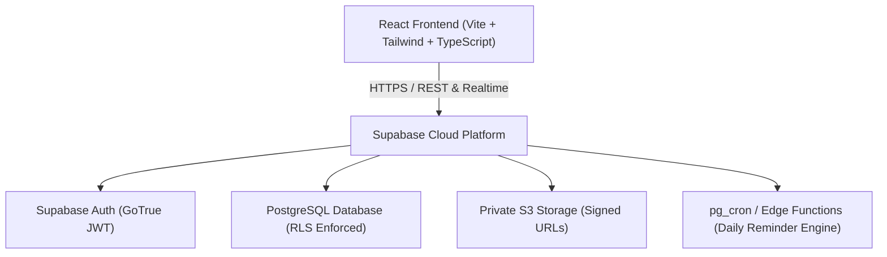
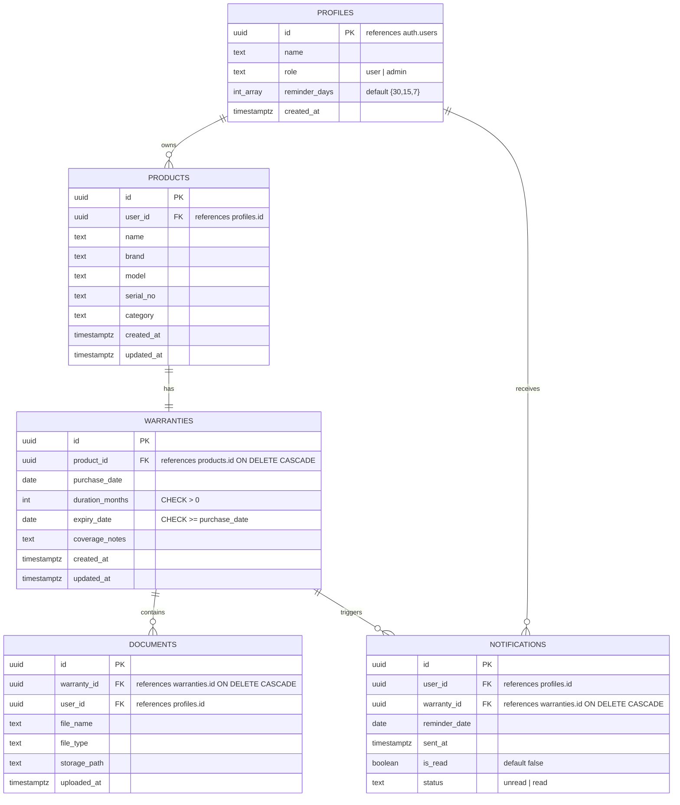

# 🛡️ WarrantyVault — Project Defense & Technical Documentation

> **Project Name**: WarrantyVault  
> **Tagline**: *"You’ll need the warranty the day after it expires."*  
> **Author**: Parth Sharma  
> **Repository**: [https://github.com/parthashamrma/WarrantyVault.git](https://github.com/parthashamrma/WarrantyVault.git)  
> **Tech Stack**: React 18 (TypeScript), Vite, Tailwind CSS, Supabase Cloud (PostgreSQL 15, GoTrue Auth, Private Storage)

---

## 1. Executive Summary & Problem Statement

### The Problem
Consumer electronics, appliances, and tools come with warranties ranging from 6 months to 10 years. However, the majority of consumers:
1. **Misplace Proof of Purchase**: Paper receipts fade, warranty cards are lost in drawers, and digital invoices get buried in cluttered email accounts.
2. **Lose Track of Expiration Deadlines**: There is no standard calendar notification for warranty expiration. Consumers only discover a warranty has expired **after** a product malfunctions.
3. **Suffer Financial Loss**: Repair and replacement costs are paid out-of-pocket for issues that would have been 100% covered had the user acted days earlier.

### The Solution: WarrantyVault
WarrantyVault is a secure digital custody platform designed to solve this problem by:
- Storing invoices, warranty cards, and purchase metadata in a single encrypted vault.
- Automatically computing exact expiration dates using relational mathematics.
- Continuously tracking coverage status with an automated 3-tier warning system.
- Dispatching timely reminders at configurable intervals (30, 15, and 7 days prior).
- Providing military-grade privacy via kernel-level PostgreSQL **Row Level Security (RLS)** and time-limited **Signed URLs**.

---

## 2. System Architecture & Tech Stack



### Architectural Breakdown

| Layer | Technology | Key Responsibility |
| :--- | :--- | :--- |
| **Frontend Framework** | **React 18 (TypeScript) + Vite** | Fast Single Page Application (SPA), component modularity, strict type safety, sub-second HMR. |
| **Styling & Design System** | **Tailwind CSS + Custom CSS Variables** | Editorial brutalist visual aesthetic using *Instrument Serif* (editorial headings) & *DM Mono* (technical data), dual color modes (Dark/Light). |
| **Backend & Database** | **Supabase (PostgreSQL 15)** | Relational database hosting, automated triggers, constraints, stored functions, and atomic cascading operations. |
| **Authentication** | **Supabase Auth (GoTrue)** | Secure email/password authentication, JWT issuance, automated token refresh, session persistence in `sessionStorage`. |
| **File Storage** | **Supabase Private Storage** | Private S3-compatible bucket (`warranty-docs`) with folder-level isolation and time-limited HMAC Signed URLs (60s TTL). |
| **Security Layer** | **PostgreSQL Row Level Security (RLS)** | Kernel-level data isolation ensuring complete multi-tenant boundaries (User A cannot view User B’s data). |
| **Testing Suite** | **Vitest + React Testing Library** | 16 automated unit and integration tests covering form validation, calculations, and RLS data isolation. |

---

## 3. Database Schema & Data Modeling

The database is built on **PostgreSQL 15** with strict relational integrity, foreign key constraints, `ON DELETE CASCADE` triggers, and check constraints.



### Table Definitions & Key Constraints

1. **`profiles`**:
   - `id UUID PRIMARY KEY REFERENCES auth.users(id) ON DELETE CASCADE`
   - Automatically populated upon registration via the `handle_new_user()` trigger.
   - Holds user preferences like `reminder_days INT[] DEFAULT '{30,15,7}'`.
2. **`products`**:
   - Stores device attributes: `name`, `brand`, `model`, `serial_no`, `category`.
   - Indexed on `user_id` and common search fields (`name`, `brand`).
3. **`warranties`**:
   - Linked to `products` via `product_id REFERENCES products(id) ON DELETE CASCADE`.
   - `CHECK (duration_months > 0)` and `CHECK (expiry_date >= purchase_date)`.
   - Automated expiration trigger computes `expiry_date = purchase_date + (duration_months * INTERVAL '1 month')`.
4. **`documents`**:
   - Tracks file metadata (`file_name`, `file_type`, `storage_path`).
   - Links to `warranty_id` with `ON DELETE CASCADE`.
5. **`notifications`**:
   - Stores scheduled reminder logs: `reminder_date`, `sent_at`, `is_read`, `status`.

---

## 4. Key Modules & Functional Workflows

### 4.1 Authentication & Session Management
- **Registration**: Captures full name, email, and password. Creates the user in Supabase Auth and triggers profile creation.
- **Session Security**: Session tokens are maintained via `sessionStorage`. Closing the browser or opening a fresh session resets visitor state to unauthenticated, ensuring shared devices are secure.
- **Route Protection**: `<ProtectedRoute>` guards private routes and redirects unauthorized visitors to `/login`.

### 4.2 Product & Warranty Engine
- **Unified Entry Flow**: Allows users to input product details, calculate duration, and upload receipts in one clean step.
- **Expiry Mathematics**:
  $$\text{Expiry Date} = \text{Purchase Date} + \text{Duration Months}$$
- **Date Convention**: The expiry date itself is the final valid day of coverage. A warranty transitions to **Expired** starting the following day.
- **Status Classification**:
  - 🟢 **Active**: `Today < Expiry Date - 30 days`
  - 🟡 **Expiring Soon**: `Today >= Expiry Date - 30 days` AND `Today <= Expiry Date`
  - 🔴 **Expired**: `Today > Expiry Date`

### 4.3 Secure Document Storage (Private Bucket)
- **Private Storage**: Stored in a private Supabase bucket named `warranty-docs`. Public URL access is disabled at the storage engine level.
- **Folder Path Isolation**: Documents are organized by user ID:  
  `{user_id}/{warranty_id}/{safe_timestamp_filename}.ext`
- **Signed URLs**: When viewing or downloading, the app requests a short-lived HMAC-signed URL valid for **60 seconds only**.
- **File Validation**: Enforces client-side and server-side checks: PDF, PNG, JPG only, max 5 MB per file.

### 4.4 Automated Reminder Engine
- A daily cron job (`pg_cron` or Edge Function) checks active warranties.
- Compares `expiry_date - CURRENT_DATE` against each user’s configured `reminder_days` array.
- Prevents duplicate alerts using unique constraint checks on `(user_id, warranty_id, reminder_date)`.
- Updates the navbar notification bell with real-time unread count badges.

### 4.5 Inventory Search, Filtering & Views
- **Real-Time Filtering**: Instant keyword search across product name, brand, model, and serial number.
- **Filter Pills**: One-click filters for *Active*, *Expiring Soon*, and *Expired*.
- **Category & Brand Selectors**: Dynamically extracted from user inventory.
- **View Toggle**: Switch between responsive Grid Cards and compact List Rows.

### 4.6 Admin Module (Zero Document Leakage)
- Admin users can access high-level aggregate metrics at `/admin`.
- Powered by a PostgreSQL `SECURITY DEFINER` function: `get_admin_stats()`.
- **Privacy Guarantee**: Returns numerical statistics only (total users, total warranties, uploads count). Admins have **zero access** to user files, receipts, or personal document URLs.

---

## 5. Security & Row Level Security (RLS) Deep Dive

Security is enforced at the database kernel level through PostgreSQL Row Level Security (RLS). Every table has RLS enabled by default.

### 1. Own Rows Only Policy
```sql
CREATE POLICY "Users can only manage their own products"
  ON products FOR ALL
  USING (auth.uid() = user_id)
  WITH CHECK (auth.uid() = user_id);
```

### 2. Relational Subquery Policies
For child tables like `warranties` and `documents`, ownership is validated by verifying that the related product belongs to the authenticated user:
```sql
CREATE POLICY "Users can only access warranties for their products"
  ON warranties FOR ALL
  USING (
    EXISTS (
      SELECT 1 FROM products
      WHERE products.id = warranties.product_id
        AND products.user_id = auth.uid()
    )
  );
```

### 3. Private Storage Policies
Users are strictly confined to their own directory inside the storage bucket:
```sql
CREATE POLICY "Users can only upload to their folder"
  ON storage.objects FOR INSERT
  WITH CHECK (
    bucket_id = 'warranty-docs' AND
    (storage.foldername(name))[1] = auth.uid()::text
  );
```

---

## 6. Mobile Responsiveness & UI Engineering

The application provides a responsive experience across desktops, tablets, and mobile devices:

1. **Non-Colliding Mobile Navbar**:
   - Fixed height (`56px`) with vertical alignment prevents button collision or awkward wrapping.
   - Public mobile view displays a compact `Sign in` button, Theme toggle, and Hamburger menu toggle.
   - The slide-down drawer menu provides touch-friendly navigation for *The clock*, *Features*, *How it works*, and full-width authentication buttons.
2. **Native-App Bottom Navigation**:
   - On screens `< 768px`, authenticated users get a native mobile tab bar fixed to the bottom:
     - 🏠 **Home** (Dashboard)
     - 🗄️ **Vault** (Inventory)
     - ➕ **Add** (Central elevated button)
     - 🔔 **Alerts** (Notification bell with live unread badge)
     - 👤 **Profile** (Account settings)
   - Layout applies `pb-24 md:pb-0` and respects iOS/Android safe area insets (`env(safe-area-inset-bottom)`).
3. **Responsive Visual Elements**:
   - The animated countdown clock scales with `clamp(4.5rem, 24vw, 8rem)`.
   - The receipt slip widget scales down to fit narrow 320px screens without overflow.
   - Inventory filter pills support horizontal touch swiping (`overflow-x-auto`).

---

## 7. Testing & Quality Assurance

The codebase includes **16 automated Vitest tests** covering:
- ✅ Invalid login credential rejection with user-friendly errors.
- ✅ Registration required-field validations (name length, email regex, password matching).
- ✅ Missing purchase date validation on warranty creation.
- ✅ Automated expiry calculation verification (`purchase_date + duration_months`).
- ✅ Disallowed document types rejection (validates MIME types & 5MB size limit).
- ✅ Full-text inventory search functionality.
- ✅ Expiry status calculation (*Active*, *Expiring Soon*, *Expired*).
- ✅ Multi-tenant RLS isolation: verifies that User A cannot read, query, or delete User B’s data.
- ✅ Warranty update and cascade deletion.

---

## 8. Teacher Viva Voce & Evaluation Q&A

### Q1: Why did you choose Supabase instead of a custom Express/Node.js backend?
> **Answer**:  
> Supabase provides a managed PostgreSQL database with native Row Level Security (RLS), GoTrue JWT authentication, and S3-compatible private storage. Instead of writing boilerplate CRUD endpoints and maintaining an intermediary server layer, authorization is enforced directly at the database engine level. This reduces network latency, eliminates API vulnerability vectors, and guarantees that data policies cannot be bypassed even if the client-side code is modified.

### Q2: What happens if an attacker tries to query another user's warranty using their ID?
> **Answer**:  
> PostgreSQL automatically rejects the query. Because Row Level Security is active, PostgreSQL intercepts every SQL statement and appends `WHERE auth.uid() = user_id` using the cryptographically verified JWT token. If the ID does not match the token's UID, the database returns an empty result set (0 rows) and denies write or delete permissions.

### Q3: How are invoice receipts kept private from search engines and unauthorized users?
> **Answer**:  
> The `warranty-docs` bucket is strictly private. Public URL generation is disabled. The application generates temporary HMAC-signed URLs via `supabase.storage.createSignedUrl()`. These links are valid for only 60 seconds. Once expired, the URL ceases to function, preventing unauthorized sharing or crawling.

### Q4: How does the system avoid duplicate notifications?
> **Answer**:  
> The notification engine checks for existing records matching `(user_id, warranty_id, reminder_date)` before inserting a reminder. If a record already exists for that threshold date, the insertion is skipped.

### Q5: What is the date convention used for warranty expiry?
> **Answer**:  
> Expiry date equals purchase date plus duration in months. The expiration date itself is considered the final day of active coverage. The warranty transitions to *Expired* starting the following day.

---

## 9. 2-Minute Live Demonstration Script

1. **Public Landing Page (`/`)**:
   - Show the hero typography, the animated printing receipt slip, and the interactive scroll-driven warranty timeline.
   - Demonstrate the light/dark mode toggle and mobile responsive drawer.
2. **User Registration & Login (`/login`)**:
   - Show the combination dial animation responding to keystrokes.
   - Demonstrate client-side password strength validation.
3. **Overview Dashboard (`/dashboard`)**:
   - Highlight the 4 metric counters (*Total*, *Active*, *Expiring Soon*, *Expired*).
   - Point out the urgent action banner for items expiring soon.
4. **Registering a Warranty (`/add`)**:
   - Enter a product (e.g. *LG Washing Machine*), set purchase date and duration (12 months).
   - Point out that the expiration date and status badge calculate automatically.
   - Attach a sample receipt PDF and click **Save & Secure**.
5. **Inventory Vault (`/warranties`)**:
   - Search by brand or model name.
   - Filter using the status pills (*Expiring Soon*, *Active*).
   - Toggle between Grid Cards and List Table view.
6. **Warranty Details (`/warranties/:id`)**:
   - Click the attached document and demonstrate the 60-second temporary signed URL download.
7. **Mobile View**:
   - Toggle Chrome DevTools (`Ctrl+Shift+M`) to show the fixed bottom tab bar on mobile screens.

