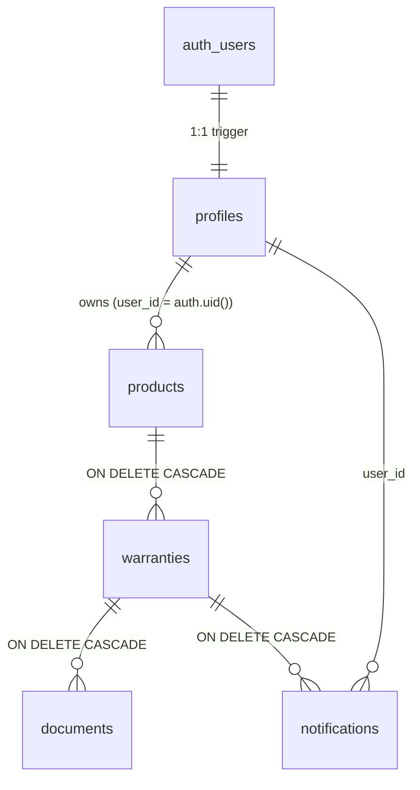

# WarrantyVault — Warranty Storage & Management System

> *"You’ll need the warranty the day after it expires."*

WarrantyVault is a complete full-stack web application designed to securely store product warranty information and proof documents, automatically calculate expiration dates, track real-time coverage status, and dispatch scheduled reminders before warranties lapse.

Built with an editorial brutalist design aesthetic featuring **DM Mono**, **Instrument Sans**, and **Instrument Serif**, parchment tones (`#ECE6D8`, `#16130F`), grain overlays, and physics-driven scroll animations.

---

## Features

- **Full Auth & Profile Custody**: Supabase Auth (email/password), session persistence, combination vault dial graphic, password strength meter, and custom notification threshold preferences (`[30, 15, 7]` days).
- **Automated Expiry Calculation**: Enter purchase date and duration in months; the database and frontend automatically compute exact calendar expiration dates (accounting for leap years and variable month lengths).
- **Real-Time Status Engine**:
  - 🟢 **Active**: More than 30 days remaining.
  - 🟡 **Expiring Soon**: 30 days or fewer remaining (or within user's configured warning threshold).
  - 🔴 **Expired**: The day after expiry date.
  *(Date convention: Expiry date is the final day of active coverage; it expires the calendar day after).*
- **Private Document Vault**:
  - Invoices, warranty cards, and retail receipts stored in a **private** Supabase Storage bucket (`warranty-docs`).
  - Supported formats: **PDF, PNG, JPG/JPEG** (max 5 MB).
  - Client-side & storage bucket validation with safe sanitized random filenames.
  - Access is granted **exclusively via short-lived signed URLs (60s validity)**. Zero public links.
- **Strict Row Level Security (RLS)**:
  - Enabled across all tables: `profiles`, `products`, `warranties`, `documents`, `notifications`.
  - Storage paths strictly isolated to `{user_id}/{warranty_id}/{random_file}`.
  - User A cannot view, modify, or download User B's records or files.
- **Admin Aggregate Terminal**:
  - Administrator access to high-level system statistics (user count, warranty count, status distribution).
  - Executed via `SECURITY DEFINER` function `get_admin_stats()`.
  - **Zero access to raw user files or document contents**.
- **Automated Reminder Engine**:
  - Scheduled daily job (`generate_warranty_reminders()`) runnable via `pg_cron` or Supabase Edge Function.
  - De-duplicated daily alerts dispatched at 30, 15, and 7 days.
  - In-app Notifications center with read/unread filtering and live navbar badge.
- **Search, Filter & Sort Hub**:
  - Instant keyword search across name, brand, model, and serial number.
  - Filter pills (All, Active, Expiring Soon, Expired), category and brand dropdowns, and sort options.
  - Toggle between Grid and List/Table view.

---

## Tech Stack

| Layer | Technology |
|---|---|
| **Frontend** | React 19, Vite 6, TypeScript, React Router 7, Tailwind CSS |
| **Typography** | Instrument Serif, Instrument Sans, DM Mono |
| **Backend** | Supabase (Postgres, Auth, Storage, Edge Functions) |
| **Client SDK** | `@supabase/supabase-js` v2 |
| **Testing** | Vitest 3, React Testing Library, JSDOM |

---

## Database Architecture (`/supabase`)

```
supabase/
├── migrations/
│   ├── 20261102000001_schema.sql      # Tables, constraints, triggers, indexes, status views
│   ├── 20261102000002_policies.sql    # Complete RLS policies & SECURITY DEFINER admin function
│   ├── 20261102000003_storage.sql     # Private bucket "warranty-docs" & object RLS policies
│   └── 20261102000004_reminders.sql   # generate_warranty_reminders() procedure & pg_cron schedule
├── functions/
│   └── reminders/
│       └── index.ts                   # Supabase Edge Function for daily cron trigger
├── seed.sql                           # Seed demo accounts (user & admin) & 3-status sample warranties
└── tests/
    └── rls_test.sql                   # SQL test script verifying User A / User B isolation
```

### Table Relationships



---

## Getting Started

### 1. Prerequisites
- Node.js (v18+ recommended)
- npm or pnpm
- Supabase account (or local Supabase CLI)

### 2. Setup Environment Variables

Copy `.env.example` to `.env`:

```bash
cp .env.example .env
```

Add your Supabase project credentials:

```env
VITE_SUPABASE_URL=https://your-project-ref.supabase.co
VITE_SUPABASE_ANON_KEY=your-supabase-anon-key
```

> **Security Notice:** Use the **ANON** key only. Never expose your `service_role` key in frontend code.
> If no credentials are provided or when developing offline, the application seamlessly activates its built-in **Local Demo Vault mode** (with pre-seeded accounts and interactive persistence).

### 3. Apply Supabase Database Migrations

In your Supabase project dashboard (SQL Editor) or using Supabase CLI:

1. Run `supabase/migrations/20261102000001_schema.sql` (Creates tables, triggers, and views).
2. Run `supabase/migrations/20261102000002_policies.sql` (Enables RLS on all tables).
3. Run `supabase/migrations/20261102000003_storage.sql` (Creates private `warranty-docs` bucket & storage policies).
4. Run `supabase/migrations/20261102000004_reminders.sql` (Installs reminder procedure).
5. *(Optional)* Run `supabase/seed.sql` to populate sample accounts and items.

### 4. Install & Run Application

```bash
# Install dependencies
npm install

# Start Vite dev server
npm run dev
```

The application will launch at `http://localhost:5173`.

---

## Pre-Seeded Demo Credentials

| Role | Email | Password | Access Level |
|---|---|---|---|
| **Member** | `demo@warrantyvault.app` | `Password123!` | Standard vault owner (5 sample items across all 3 statuses) |
| **Admin** | `admin@warrantyvault.app` | `AdminPass123!` | Administrator terminal (aggregate stats, zero file access) |

*(Quick 1-click login buttons for both roles are available on the Sign In page).*

---

## Running Tests

### Automated Unit & Integration Tests (Vitest)

```bash
npm test
```

Covers:
- Standard and leap-year expiration date calculations
- Active, Expiring Soon, and Expired status rules
- Disallowed file types (script.sh, malware) and oversized files (> 5MB)
- Sanitized unguessable storage path generation
- Invalid login and required field validation
- Warranty creation, editing, and deletion with cascading cleanup
- User data isolation between accounts
- Admin terminal route protection

### RLS Isolation Test Script (Postgres)

Execute `supabase/tests/rls_test.sql` in the Supabase SQL Editor. It verifies:
- User B cannot read User A's products, warranties, or documents (`SELECT` returns 0).
- User B cannot modify or delete User A's rows (`UPDATE`/`DELETE` affects 0 rows).
- Non-admin callers fail with `Access denied` when attempting to call `get_admin_stats()`.

---

## Future-Ready Architecture

The codebase is structured modularly to support planned enhancements:
- **OCR Receipt Extraction**: File upload hook in `AddWarrantyPage.tsx` can pipe documents to Tesseract / Google Document AI before filling form fields.
- **SMS / Push Gateway**: Stored procedure `generate_warranty_reminders()` can invoke webhooks via `pg_net` or Edge Functions to dispatch Twilio/SendGrid notifications.
- **Family Vault Sharing**: Profiles table is decoupled from product ownership, allowing future `vault_memberships` joining tables.
- **Mobile Companion App**: The core `@supabase/supabase-js` API client and `warrantyUtils.ts` are 100% platform-agnostic for React Native reuse.

